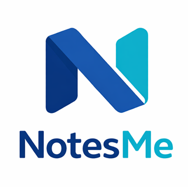
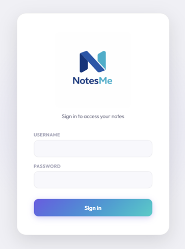
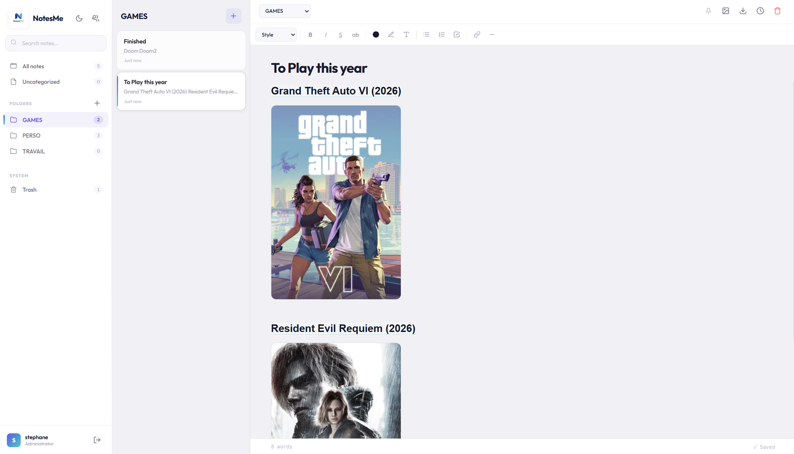
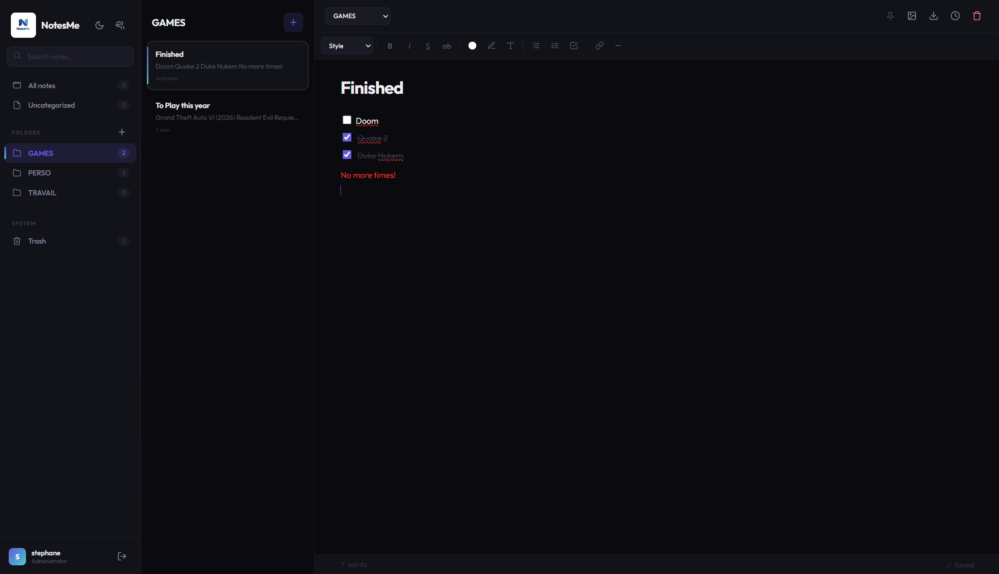
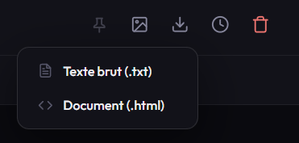
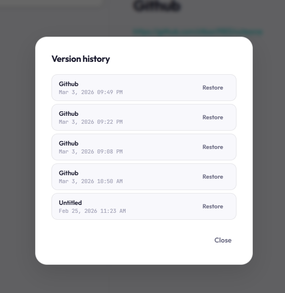
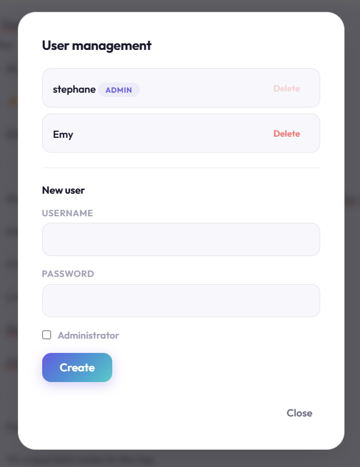

#  NotesMe

Self-hosted note-taking app — lightweight, encrypted, deployable in one command. Zero frontend dependencies, end-to-end encryption at rest, built for speed.

I spent a long time looking for a simple, self-hosted note-taking application. I tested several, but I was never satisfied:
either too advanced, with too many features,
or too simplistic, lacking folder management, backups, etc.

So I decided to create this application myself, with Claude's help.
I'm happy with it, and I hope it will be useful to others.
I think its main strengths are its simplicity, its lightweight design, and its note versioning system.

Secure - Simple - SelfHosted

Why you should try:
- Clean
- Simple
- No AI
- Notes Versionning
- Share functionnality
- Export notes
- Easy to Backup
- Markdown compatible


Read on for all the details and features!

<br>

## Demo

🎉 You want to test NotesMe right now ? You can jump to the demo site:

https://notesme.demo-portal.eu/

User: demo

password: notesme  
  
<br>
<br>

[](https://ko-fi.com/B0B21WMVF0)

<br>
<br>
  
## Screenshots:

Login:



Home:



Darkmode:



Exporting to txt or .html:



Versionning:




User management:



---

## ✨ Key Features

### 📱 PWA & Experience

- Offline Mode (Read Only)
- Installable as a native app on mobile and desktop (PWA)
- Support share from another apps
- Dark / light theme with automatic system detection
- Fully responsive interface
- Zero JavaScript frameworks — instant load times
- Handy keyboard shortcuts: Ctrl+N, Ctrl+B/I/U, Ctrl+K, and more

### 🗂️ Organization

- Unlimited nested folders and subfolders to structure your notes your way
- Pin important notes to the top of the list
- Soft-delete trash with one-click restore and configurable auto-purge
- Automatic version history — snapshots every 5 minutes, up to 50 versions per note
- Export any note to plain text (.txt) or HTML

### 📝 Rich Editor

- Full WYSIWYG editing — bold, italic, underline, colors, headings, quotes, lists, code blocks
- Interactive checklists with real-time checkbox support
- Drag & drop or paste images directly into notes, with visual resizing handles
- Link insertion with URL auto-detection and Ctrl+K shortcut
- Real-time autosave — never lose your work

### 🔒 Security

- AES encryption at rest (Fernet / AES-128-CBC + HMAC-SHA256) — optional, enabled by setting an encryption key
- Argon2id password hashing (OWASP 2024 recommendation)
- In-memory full-text search — decrypted content never touches the disk
- XSS protection via DOMPurify (client-side) and html.escape() (server-side)
- Protection against path traversal, malicious file uploads, and brute-force attacks
- JWT-based authentication with configurable session duration

### 👥 Multi-user Support

- Admin panel for user management
- Full data isolation — each user's notes, folders, and trash are completely private

### 🤖 Optional MCP server

- Opt-in, read-only [MCP](https://modelcontextprotocol.io) endpoint: let Claude Desktop (or any MCP client) search and read your notes
- Per-user personal access tokens, revocable at any time — see [MCP server](#-mcp-server--search-your-notes-from-claude-desktop)

---

## 🚀 Deployment

### Prerequisites

- Docker or/and Docker Compose

### Installation

#### One line command:

```bash

# 1. Create the environment file
cp .env.example .env

# 3. Edit .env with your values
#    - Set a strong password
#    - Generate an encryption key (see below)
vim .env

# 4. Adapt the volume path

# 5. Launch
docker run -d -p 8080:8080 -v ./:/app/data ghcr.io/stban1983/notesme:latest
```

#### Or use docker compose:

```
services:
  notesme:
    image: ghcr.io/stban1983/notesme:latest
    container_name: notesme
    restart: unless-stopped
    ports:
      - "6807:8080"
    volumes:
      - ./data:/app/data
    env_file:
      - .env
```

The app is available at `http://localhost:6807`.

### Generate an encryption key

```bash
python3 -c "from cryptography.fernet import Fernet; print(Fernet.generate_key().decode())"
```

or go to: https://8gwifi.org/fernet.jsp

> ⚠️ **Keep this key safe.** Without it, encrypted notes are permanently unrecoverable.

---

## ⚙️ Configuration

All variables are defined in the `.env` file:

| Variable | Default | Description |
|---|---|---|
| `USERNAME` | `admin` | Initial admin account username |
| `PASSWORD` | `admin` | Initial account password — **change this** |
| `SECRET_KEY` | *(auto)* | JWT signing key (auto-generated if empty) |
| `ENCRYPTION_KEY` | *(empty)* | Fernet key for note encryption (optional) |
| `TOKEN_EXPIRY_HOURS` | `72` | Session duration in hours |
| `TRASH_RETENTION_DAYS` | `30` | Days before automatic trash purge |
| `MAX_UPLOAD_SIZE` | `10485760` | Max upload size in bytes (10 MB default) |
| `VERSION_INTERVAL_MIN` | `5` | Minimum interval between version snapshots (minutes) |
| `MAX_VERSIONS_PER_NOTE` | `50` | Maximum versions kept per note |
| `LOGIN_MAX_ATTEMPTS` | `5` | Login attempts before lockout |
| `LOGIN_WINDOW_SEC` | `900` | Lockout window in seconds (15 min default) |
| `MCP_ENABLED` | `false` | Enable the read-only MCP server on `/mcp` (see below) |
| `MCP_PUBLIC_URL` | *(empty)* | Public URL of the MCP endpoint (e.g. `https://notes.example.com/mcp`), used in the setup snippets |
| `MCP_ALLOWED_ORIGINS` | *(empty)* | Comma-separated browser origins allowed to call `/mcp` (rarely needed) |
| `MCP_RATE_LIMIT` | `120` | Max MCP requests per minute per token (`0` = unlimited) |

---

## 🔒 Security

### Encryption

Encryption is **optional** and only enabled when `ENCRYPTION_KEY` is set.

- **Algorithm**: AES-128-CBC + HMAC-SHA256 via Fernet (`cryptography` library)
- Note content is encrypted before being written to the SQLite database
- Titles and metadata are **not** encrypted (needed for sorting)
- Images are **not** encrypted (stored as files on the volume)
- The full-text search index (FTS) has been removed — search runs in-memory after decryption, ensuring no plaintext ever persists on disk

### Passwords

- Hashed with **Argon2id** (OWASP 2024 recommendation)
- Transparent migration: legacy SHA-256 hashes are automatically upgraded to Argon2 on the next successful login — no user action required

### Attack protections

- **XSS**: DOMPurify sanitization client-side with a tag whitelist, `html.escape()` server-side for exports
- **Path traversal**: `basename()` + `realpath()` validation on the image endpoint
- **Malicious uploads**: SVG banned (XSS vector), extension forced from MIME type, configurable size limit
- **Brute force**: per-IP rate limiting on the login endpoint (5 attempts / 15 min by default)


---

## 🤖 MCP server — search your notes from Claude Desktop

NotesMe can give an AI assistant access to your notes through the [Model Context Protocol](https://modelcontextprotocol.io) (MCP), so you can ask Claude Desktop things like *"What did I plan for the budget of the Italy trip?"*.

- **Opt-in**: disabled by default. NotesMe itself still contains no AI.
- **Read-only**: 4 tools — `search_notes` (multi-word, case- and accent-insensitive), `get_note` (the note converted to Markdown, checklists included), `list_notes`, `list_folders`. Nothing can be created, modified or deleted, and the trash is not exposed.
- **Per-user tokens**: each user creates their own personal access tokens. A token only gives access to its owner's notes, only through `/mcp` (it is rejected by the web API), is stored hashed and can be revoked at any time.
- **No new dependency**: the endpoint (Streamable HTTP, MCP versions 2024-11-05 → 2026-07-28) is built into `main.py`.

> ⚠️ **Privacy:** the notes the assistant reads are sent, decrypted, to your AI provider (e.g. Anthropic for Claude). Encryption at rest still protects what is stored on your server.

### 1. Enable it

Add to your `.env` and restart the container:

```env
MCP_ENABLED=true
# Recommended: the public URL of the endpoint, shown in the setup snippets
MCP_PUBLIC_URL=https://notes.example.com/mcp
```

An **MCP access** entry appears in the sidebar (System section).

### 2. Create a token

**MCP access** → enter a name → **Create token**. Copy the token and the snippets right away: the token is shown only once.

### 3. Connect Claude Desktop

Claude Desktop only launches local (stdio) MCP servers from its config file, so NotesMe is reached through the [`mcp-remote`](https://www.npmjs.com/package/mcp-remote) bridge, which needs **Node.js 20+** on your computer. Open the config file (Claude Desktop: *Settings → Developer → Edit Config*):

- Windows: `%APPDATA%\Claude\claude_desktop_config.json`
- macOS: `~/Library/Application Support/Claude/claude_desktop_config.json`

and paste the snippet generated by NotesMe:

```json
{
  "mcpServers": {
    "notesme": {
      "command": "npx",
      "args": ["-y", "mcp-remote@0.14.3", "https://notes.example.com/mcp",
               "--transport", "http-only", "--header", "Authorization:${NOTESME_AUTH}"],
      "env": { "NOTESME_AUTH": "Bearer nm_your_token" }
    }
  }
}
```

Restart Claude Desktop: the *notesme* tools appear in the tools menu.

- The connection is made **from your computer**, so it also works with an instance only reachable on your LAN or VPN. For a plain `http://` URL, add `"--allow-http"` to `args` (the generated snippet does it for you).
- Keep `Authorization:${NOTESME_AUTH}` as is, without a space after the colon: Claude Desktop on Windows doesn't escape spaces in arguments.
- If the token is wrong or revoked, `mcp-remote` tries an OAuth sign-in that NotesMe doesn't offer and fails: create a new token.

### Claude Code

```bash
claude mcp add --transport http notesme https://notes.example.com/mcp --header "Authorization: Bearer nm_your_token"
```

### claude.ai custom connectors (web & mobile)

Custom connectors are called from Anthropic's cloud, so your instance must be reachable over **public HTTPS**. NotesMe doesn't implement OAuth: this only works if your Claude plan offers the (beta) *request headers* option for custom connectors — add `https://notes.example.com/mcp` with the header `Authorization: Bearer nm_your_token`. Otherwise, use Claude Desktop as above.

### Behind a reverse proxy

- Forward the `Authorization` header and don't redirect `/mcp`.
- Set `TRUSTED_PROXY_COUNT=1` so the invalid-token limiter sees the real client IPs.
- Requests with an `Origin` header (browser-based clients) are only accepted from the origin of `MCP_PUBLIC_URL` and from `MCP_ALLOWED_ORIGINS`.

### Security notes

- Tokens are 256-bit random secrets stored as SHA-256 hashes. Revoke them from **MCP access**; deleting a user deletes their tokens.
- Each token is limited to `MCP_RATE_LIMIT` requests per minute. After 20 invalid tokens from the same IP within `LOGIN_WINDOW_SEC`, further invalid tokens from that IP get HTTP 429 (valid tokens are never blocked).
- Notes may contain text imported from the web (share target). The assistant receives it as data, but as with any AI tool, beware of prompt injection.

---

## 📁 Data structure

The `./data` volume contains:

```
data/
├── notes.db      # SQLite database (notes, folders, users, versions)
└── uploads/      # Uploaded images (UUID.ext)
```

> 💡 Back up this directory regularly, along with your encryption key.

---

## 🏗️ Tech stack

| Component | Technology |
|---|---|
| Backend | Python 3.12, FastAPI, SQLite (WAL mode), Fernet, Argon2 |
| Frontend | Vanilla JS, HTML/CSS — zero frameworks, zero bundlers |
| Sanitization | DOMPurify (CDN) |
| Auth | JWT (PyJWT) |
| Container | `python:3.12-slim` (~90 MB) |
| PWA | Service Worker + manifest.json |

---

## ⌨️ Keyboard shortcuts

| Shortcut | Action |
|---|---|
| `Ctrl + N` | New note |
| `Ctrl + B` | Bold |
| `Ctrl + I` | Italic |
| `Ctrl + U` | Underline |
| `Ctrl + K` | Insert link |
| `Ctrl + Shift + X` | Strikethrough |
| `Ctrl + Shift + L` | Bullet list |

---


## 📄 License

MIT
